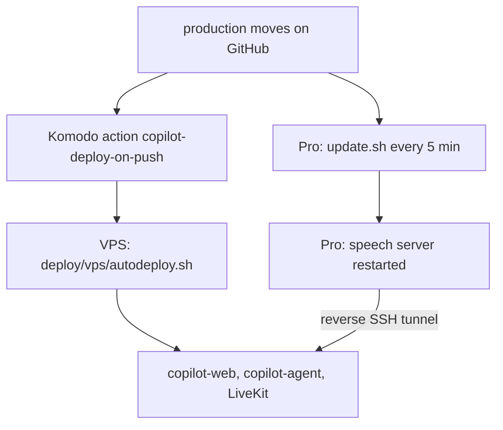

# Deploying the copilot lab

A merge to `main` goes live by itself: when CI passes, `.github/workflows/promote.yml` moves `production` to that commit and the lab deploys ([decision 0016](../docs/decisions/0016-merges-go-live.md), which replaces 0015). You can still move `production` by hand with `git push origin main:production`, for example to roll back one commit. The site is https://copilot.design-bakery.com.

1. Komodo's `copilot-deploy-on-push` action checks GitHub every 5 minutes. When `production` is ahead of the running `copilot-web` image, it deploys the `copilot` stack.
2. That stack's pre-deploy runs [`vps/autodeploy.sh`](vps/autodeploy.sh). It builds both images tagged with the commit, swaps the containers, and waits for `/api/health`. If the health check fails, it puts the previous images back.
3. On the MacBook Pro, [`pro/update.sh`](pro/update.sh) moves its checkout to `production` within 5 minutes and restarts the speech server.

## Where each part runs

| Part | Machine | How it's reached |
|---|---|---|
| Site and `/api` (`server.ts`) | VPS, `copilot-web` | Cloudflare tunnel A → `copilot-web:8787` |
| LiveKit signalling | VPS, `copilot-livekit:7880` | through `server.ts` at `/rtc` |
| Call audio (WebRTC) | VPS, `copilot-livekit` | the VPS's public address, TCP 7881 and UDP 7882 |
| Voice agent (`speech/agent.py`) | VPS, `copilot-agent` | joins every call's room |
| Speech models, all five stacks (`speech/server.py`) | Pro, `com.pukujan.copilot-speech` | reverse tunnel → VPS `127.0.0.1:18799` |
| LFM3-Audio (the `lfm3-audio` stack) | Pro, started by the speech server | reverse tunnel → VPS `127.0.0.1:18798` |
| LFM3 text model | Pro, `com.pukujan.lfm3` | nyc-map-agent's tunnel and bridge → `18099` |

The speech models stay on the Pro because Whisper (mlx-whisper) and LFM3-Audio's llama.cpp build run on Apple's GPU, where the voice matrix tested them (#82). Only the stack a call uses is loaded (decision 0014). If the Pro is asleep, voice calls fail, but text chat still works.

## Keys

The containers read `~/apps/copilot.env` on the VPS (mode 600, never in git):

| Name | From |
|---|---|
| `OPENROUTER_JEV_KEY` | `openrouter_jev_only` in `~/Documents/projects/.env` |
| `OCTO_KEY`, `OCTO_WORKSPACE` | `octo_db_chatbots`, `octo_db_chatbots_workspace` |
| `SIGNING_SECRET` | random, made on the VPS |
| `LIVEKIT_API_KEY`, `LIVEKIT_API_SECRET`, `LIVEKIT_KEYS` | random, made on the VPS; `LIVEKIT_KEYS` is `key: secret` |

## First-time setup (done once, 2026-11-01)

- VPS: `git clone https://github.com/Pukujan-lab/voice-agent-research ~/apps/copilot`, write `~/apps/copilot.env`, then run `deploy/vps/autodeploy.sh` once.
- Pro: clone the repo to `~/apps/copilot` and put the speech models in `demo/live-site/speech/models/` (sources in `speech/requirements.txt`). Then run `deploy/pro/install.sh`.
- Cloudflare: tunnel A gets the public hostname `copilot.design-bakery.com` → `http://copilot-web:8787`.
- Komodo: the `copilot` stack and the `copilot-deploy-on-push` action live in `Pukujan-lab/server-management` (`komodo/resources/stacks-vps.toml`).

## Checking it

- Health: `curl https://copilot.design-bakery.com/api/health`
- VPS logs: `ssh vps 'cd ~/apps/copilot/deploy && docker compose -f docker-compose.vps.yml logs --tail 50'`
- Pro logs: `ssh mac-pro 'tail ~/Library/Logs/copilot/*.log'`
- A commit that failed is kept in `deploy/.deploy-failed` and isn't retried. Delete that file to retry it.
