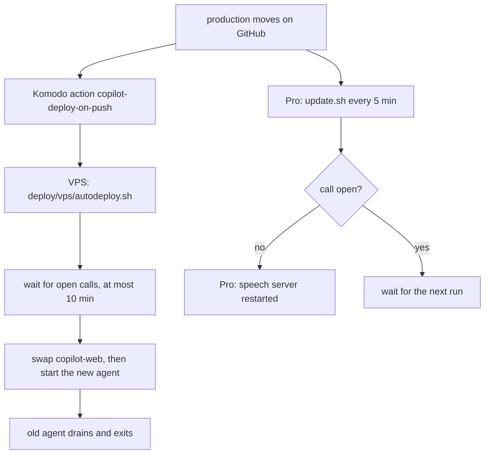

# Deploying the copilot lab

A merge to `main` goes live by itself: when CI passes, `.github/workflows/promote.yml` moves `production` to that commit and the lab deploys ([decision 0016](../docs/decisions/0016-merges-go-live.md), which replaces 0015). You can still move `production` by hand with `git push origin main:production`, for example to roll back one commit. The site is https://copilot.design-bakery.com.



1. Komodo's `copilot-deploy-on-push` action checks GitHub every 5 minutes. When `production` is ahead of the running `copilot-web` image, it deploys the `copilot` stack.
2. That stack's pre-deploy runs [`vps/autodeploy.sh`](vps/autodeploy.sh). It builds both images tagged with the commit, waits for open calls (below), swaps `copilot-web`, waits for `/api/health` (and puts the previous image back if that fails), then starts the new voice agent beside the old one.
3. On the MacBook Pro, [`pro/update.sh`](pro/update.sh) moves its checkout to `production` within 5 minutes and restarts the speech server, unless a call may be using it (below).

## A deploy does not cut a call

Every merge to `main` deploys (decision 0016), so a deploy while someone is on a call is the normal case (#67, #76). Three things keep it from hurting.

**The voice agent drains.** The agent is not in `docker-compose.vps.yml`: [`docker-compose.agent.yml`](docker-compose.agent.yml) runs one container per release (`copilot-agent-<12-char sha>`, its own compose project), so Komodo's `compose up` never replaces it. A new agent starts beside the old one and must log `registered worker` (LiveKit has accepted it) before the old one is told to stop. LiveKit sends each new call to a worker that has room, and a worker that is draining has none. The old agent gets SIGTERM; LiveKit Agents 1.8.8 (`cli/cli.py`, `worker.py`) then calls `drain()` in `start` mode: it reports itself full, keeps the jobs it holds, and exits when they end, or after `drain_timeout` (the agent sets `AGENT_DRAIN_S`, default 1200 s; the library's own default is 3600 s). `stop_grace_period` in the compose file (1230 s) is longer than that, so a plain `docker stop` also waits. `autodeploy.sh` turns the old container's restart policy off first (otherwise Docker would start it again when it exits) and does not wait for it; the next deploy removes the finished container. A call longer than 20 minutes after its agent was told to stop is cut when the drain times out.

**Anything that drops a call waits for it.** Before the site (it carries LiveKit's signalling at `/rtc`), LiveKit, or the speech bridges (only when their configuration changed) are restarted, `autodeploy.sh` lists LiveKit's rooms with the server's own key from `~/apps/copilot.env` ([`vps/open-calls.py`](vps/open-calls.py), run in a throwaway container of the agent image). If a room holds anyone but the agent it waits up to `CALL_WAIT_S` (600 s) and then goes on, so a call someone forgot to hang up cannot stop a release. If LiveKit cannot be asked it does not wait. On the Pro, `update.sh` skips its whole update (checkout and speech-server restart) while the site's `GET /api/voice/calls` says a room is open, while the speech server's `/health` reports `inflight` requests, or for `SPEECH_IDLE_S` (20 s) after the last one; launchd runs it again in 5 minutes, and after `CALL_WAIT_S` (600 s) from the first skip it goes on. A site that cannot be reached does not hold it back. The first rollout after this change has no protection on the Pro, because the old speech server and site do not report these counts yet.

**The record.** Each deploy writes a line to `deploy/deploy.log` on the VPS (and to Komodo's log), for example `deploy 3f2a9c1d4e5b: wait=gave-up waited=600s calls_at_start=1 calls_at_end=1 for='swapping the site' agent=started drained=1 restarted='web' took=655s`, and a `deploy` span to Phoenix through Octo (session `deploy-<sha>`, the same session as the voice check's eval span), with `deploy.wait_result` (`none`, `waited`, `gave-up`, `unknown`), `deploy.waited_s`, `deploy.calls_at_start`, `deploy.calls_at_end`. A call that was cut shows up next to the deploy that did it. The Pro writes its decisions to `~/Library/Logs/copilot/update.log` (`deferred, waited ...`, `still busy after ...`, `calls ended after waiting ...`).

Live check (2026-11-02, #76): two calls held open across real deploys each saw the deploy wait (`1 call(s) open; waiting up to 600s`) and then go on once the call had ended, but in both the call was already lost: the agent left each room about a minute after the caller joined, right after a `stall speech-without-turn` line, and the page's two rejoins ran out. That is a voice-agent problem, not a deploy problem, and is tracked on #76. It also means a call surviving a deploy has not yet been shown on the live site.

Limits: the wait ceiling (600 s) plus the build must fit in Komodo's pre-deploy timeout; if Komodo cuts the script earlier, lower `CALL_WAIT_S`. The first deploy after this change replaces the old fixed-name `copilot-agent` container: it is drained like any other, but Komodo's own `compose up` may remove it as an orphan of the stack, once.

Tests: `npm test` runs [`tests/deploy-keeps-calls.test.ts`](../demo/live-site/tests/deploy-keeps-calls.test.ts) (the scripts with a stand-in for `docker`, and `update.sh` in a scratch git repository). `npm --prefix demo/live-site run test:deploy-sequence` runs the whole sequence on a scratch Docker project with a real call: it deploys, starts a call with audio from macOS `say`, deploys again, and checks the call is still heard, the old agent drains and exits, and the next call goes to the new container. On the live site, `node --no-warnings tests/voice-hold.ts` (in `demo/live-site`) holds one call open and talks every 30 s, so a deploy that lands during it shows in its output whether the call survived.

## The agent sleeps between calls

The voice agent holds about 1.2 GB, and calls come in bursts with hours between them, so it does not run all day (#117). The VPS's one Sablier (server-management `komodo/resources/platform.toml`) stops a container labelled `sablier.enable` 10 minutes after the last request for it, with a plain `docker stop`, and starts it again when asked. The agent connects out to LiveKit, so nothing ever reaches it that could wake it; the site does it ([`sablier.ts`](../demo/live-site/sablier.ts)):

- When the widget loads (`POST /api/voice/options`), the site asks Sablier to start the agent and does not wait, at most once a minute.
- When the call button is pressed (`POST /api/voice/token`), the site waits for the agent, up to 30 s, before it hands out the room's token. LiveKit gives a new room's job only to the workers registered when the room is created, so the agent has to be up first. The caller hears the ringback meanwhile. If the agent is not up in time, the token is handed out anyway and the page falls back to text after 45 s with no agent.
- The agent is ready when its container is healthy: `speech/agent.py` writes `/run/agent/registered` once the worker has registered with LiveKit. LiveKit Agents' own check on port 8081 answers before that. The directory is a tmpfs, which Docker empties on every start. A stopped container keeps the rest of its filesystem: when the file was in `/tmp`, the one from the last run made a woken agent look ready 7 s too early, and the call that woke it got no agent.
- During a call the agent renews its own Sablier session every minute (`keep_awake`), so a call longer than 10 minutes is not cut.

The site wakes the agent by its container name, `SABLIER_AGENT`, which `autodeploy.sh` writes into `deploy/.env` as `COPILOT_AGENT_CONTAINER` beside the web image. It never wakes by group, because the group also holds the stopped agents of older releases. A deploy treats a sleeping agent of the release as present and does not start another. It removes an old release's sleeping agent at once (it holds no call), and the next deploy's `reap_agents` removes only agents that finished draining (restart policy off), so a failed deploy still has its previous agent to go back to. An agent started by a deploy gets Sablier's default session (`auto-warm-externally-started`) and sleeps after 10 idle minutes like any other. Without `SABLIER_URL` or an agent name (local runs, tests) the site calls nothing.

A new agent registered with LiveKit in 6 to 14 s in the 15 deploys before this change (`grep "registered with LiveKit" deploy/deploy.log`); a woken one is timed after the first deploy. Between the site's swap and the new agent registering (about 8 s of each deploy), the site names an agent that does not exist yet: the wake fails at once and the old agent, which still runs then, takes the call. If the old agent was asleep, a call in that moment gets no agent.

## Where each part runs

| Part | Machine | How it's reached |
|---|---|---|
| Site and `/api` (`server.ts`) | VPS, `copilot-web` | Cloudflare tunnel A → `copilot-web:8787` |
| LiveKit signalling | VPS, `copilot-livekit:7880` | through `server.ts` at `/rtc` |
| Call audio (WebRTC) | VPS, `copilot-livekit` | the VPS's public address, TCP 7881 and UDP 7882 |
| Voice agent (`speech/agent.py`) | VPS, `copilot-agent-<sha>` (one per release; the old one drains; asleep between calls) | joins every call's room; woken through Sablier by the site |
| Speech models, all five stacks (`speech/server.py`) | Pro, `com.pukujan.copilot-speech` | reverse tunnel → VPS `127.0.0.1:18799` |
| LFM3-Audio (the `lfm3-audio` stack) | Pro, started by the speech server | reverse tunnel → VPS `127.0.0.1:18798` |
| LFM3 text model | Pro, `com.pukujan.lfm3` | nyc-map-agent's tunnel and bridge → `18099` |

The speech models stay on the Pro because Whisper (mlx-whisper) and LFM3-Audio's llama.cpp build run on Apple's GPU, where the voice matrix tested them (#82). Only the stack a call uses is loaded (decision 0014). If the Pro is asleep, voice calls fail, but text chat still works.

## Keys

The containers read `~/apps/copilot.env` on the VPS (mode 600, never in git):

| Name | From |
|---|---|
| `OPENROUTER_JEV_KEY` | `openrouter_jev_only` in `~/Documents/projects/.env` |
| `OCTO_KEY`, `OCTO_WORKSPACE` | `octo_db_chatbots`, `octo_db_chatbots_workspace` |
| `SIGNING_SECRET` | random, made on the VPS |
| `LIVEKIT_API_KEY`, `LIVEKIT_API_SECRET`, `LIVEKIT_KEYS` | random, made on the VPS; `LIVEKIT_KEYS` is `key: secret` |
| `OPENBAO_ADDR`, `OPENBAO_ROLE_ID`, `OPENBAO_SECRET_ID` | OpenBao on the VPS (server-management `vps/openbao/`): `http://openbao:8200` and the `copilot` AppRole. Without them the site refuses to save a call record (503) rather than store it readable (#128) |
| `COPILOT_API_URL` (agent) | Where the voice agent sends a recorded call's audio, signed with `SIGNING_SECRET`; set in `docker-compose.agent.yml` to `http://copilot-web:8787`. A business's calls are recorded unless its config says `recording: { audio: false }`; the site locks the audio with the call's key (#130) |

## Model slots (the desk hybrid is the default)

[Decision 0017](../docs/decisions/0017-smart-model-slots-for-development.md) as amended (2026-11-02, #101): LFM3 answers every ordinary turn and does the talking; a hard desk turn escalates to the slot's smart hosted model **by default, for every visitor** — no sign-in, no opt-in. `DESK_HYBRID=0` turns the escalation off. "Smart always" (every turn) still needs a development host or the owner's token. [`demo/live-site/model-slots.json`](../demo/live-site/model-slots.json) names, per slot, a provider and a model. The server validates it when it starts and stops with a message naming the slot if something is wrong. The shipped file names `local` for every slot, which keeps everything on LFM3; the VPS env sets the `desk` slot.

| Slot | What it decides |
|---|---|
| `desk` | tool and form decisions (the smart model takes a hard turn, by default) |
| `reply` | the spoken reply |
| `rewrite` | question rewrite and clarifying questions |
| `judge2` | a second opinion only where Jev is tied |
| `eval` | test generation and simulated callers (offline) |

| Provider | Model | Key name (env) | Reached at |
|---|---|---|---|
| `local` | LFM3 | none | `LLAMA_URL` / `DESK_URL` |
| `inferhub` | `deepseek-v4.1-flash` and nothing else (see below) | `INFERHUB_API_KEY` | the Octo vault proxy to InferHub (`INFERHUB_BASE_URL` overrides) |
| `openrouter-free` | a named model ending in `:free` | `OPENROUTER_FREE_KEY` | OpenRouter |
| `workbuddy` | a model WorkBuddy serves | `WORKBUDDY_KEY` | the Octo vault proxy (`WORKBUDDY_URL` overrides) |

Env overrides, validated by the same rules: `SLOT_<NAME>_PROVIDER`, `SLOT_<NAME>_MODEL`, `SLOT_<NAME>_TIMEOUT_MS` (500 to 60000, default 8000) and `SLOT_<NAME>_DAILY_CAP` (default `SMART_DAILY_CAP`, or 300). For example `SLOT_DESK_PROVIDER=inferhub SLOT_DESK_MODEL=deepseek-v4.1-flash`. Switching a slot's provider by env does not carry the file's model over.

The allow-list rejects any model name containing `claude`, `gemma` or `openrouter/free`, whatever the provider. `openrouter-free` needs a `:free` model, and `inferhub` takes exactly one model (below); any other name stops the server at start with a message naming the slot.

### InferHub: one model, vendor routes, a 30-day lease

The owner limited `inferhub` to **`deepseek-v4.1-flash`** (decision 0017). A slot names that id (InferHub then picks a vendor itself) or one vendor route of it: `cb/`, `cbcn/`, `ali/`, `cp/cline-pass/` or `ocg/` followed by `deepseek-v4.1-flash`. Every other name, other DeepSeek and Qwen models included, is rejected when the server starts. The ids were checked against InferHub's `/v1/models` on 2026-11-02.

```json
{ "version": 1, "slots": { "desk": { "provider": "inferhub", "model": "deepseek-v4.1-flash" } } }
```

**Fallbacks.** A smart call tries the named id, then the other vendor routes in the order the old LiteLLM gateway used (`cb`, `cbcn`, `ali`, `cp/cline-pass`, `ocg`), moving on after an HTTP 402 (no vendor under the price cap), 429, 5xx or a network failure. The slot's `timeoutMs` (default 8000) is the time budget for the whole walk. When every route fails or the time runs out, the turn goes on with the local model's answer, which the page already holds. A 400 stops the walk, since it would fail the same way on every route. The whole walk counts as one call of the daily cap.

**The key is a lease.** `INFERHUB_API_KEY` is an `octo_tmp_` working key leased for 30 days from the Octo vault item `inferhub`, so it works only through the vault proxy, which is why that is the default address. The owner mints the lease and keeps it in `~/Documents/projects/.env` as `inferhub_lease`; copy it to `~/apps/copilot.env` on the VPS (mode 600) as `INFERHUB_API_KEY`, then recreate the `web` container (the next deploy does it). To renew: the owner leases the vault item `inferhub` again, replaces `inferhub_lease`, and the same copy and redeploy follow. The full vault grant is never used for this. A real InferHub key works too, with `INFERHUB_BASE_URL=https://api.inferhub.dev/v1`.

**It fails closed.** With no key, the slot stays off and the log says `smart desk: inferhub needs INFERHUB_API_KEY, which is not set; the local model answers` once at start. When InferHub answers 401 or 403 (a rejected or expired lease), smart calls stop for 10 minutes, the log says `inferhub rejected the key (HTTP 401) ... renew it`, the page is told to stop asking, and that request's span in Phoenix is an error span with `copilot.smart_refused` = `auth`. The local model keeps answering throughout. The key is never logged.

**Spend.** Our own limits are the daily cap (`SMART_DAILY_CAP`, `SLOT_DESK_DAILY_CAP`) and the owner scope; InferHub's own limits belong to the seat behind the vault item. InferHub bills each request at least $0.00001 and returns the charge as `usage.cost` in the response; the account's balance and usage are on its dashboard at https://inferhub.dev (Dashboard). Phoenix shows the model and the routes tried on each span (`llm.model_name`, `copilot.smart_tried`), not the cost.

### Smart desk turns (the default hybrid)

With the `desk` slot on a hosted model, the desk asks it only for a hard turn: the local model's answer was rejected by code (a field that does not exist, a value that fails its check), or it did nothing when the caller said something. Every other turn, and every turn of the voice stacks, stays on LFM3. This is the default for every visitor now (#101); `DESK_HYBRID=0` turns it off.

| Setting | What it does |
|---|---|
| `DESK_HYBRID=0` | turns the escalation off explicitly; anything else (unset included) leaves it on |
| `DESK_KEY` | bearer key for the local model's server, when it needs one |
| `SMART_DAILY_CAP` / `SLOT_DESK_DAILY_CAP` | smart calls per UTC day (default 300); past it the page keeps the local answer |
| `SLOT_DESK_TIMEOUT_MS` | how long the hosted model gets for the whole walk down its routes (default 8000); past it the local answer stands |
| `SMART_DEV_HOSTS` | extra host names counted as development hosts (the built-in ones are `localhost`, `127.0.0.1`, `::1`, `*.localhost`, `*.test`) |
| `SMART_OWNER=1`, `OWNER_TOKEN` | the owner switch: a request carrying the token in the `x-owner-token` header or the `copilot_owner` cookie is in scope |

Scope now gates only "smart always" (a smart model for every turn, not just hard ones): a development host (the server passes the request's host name on only when nothing proxied it, so on the VPS it never is one) or the owner's token. The owner signs in once per browser — on the page (below), or `curl -X POST https://copilot.design-bakery.com/api/owner -H 'content-type: application/json' -c jar -d '{"token":"<OWNER_TOKEN>"}'`; posting an empty token signs out. Wrong tokens are limited to 10 an hour per visitor. If a gateway reports back a model whose name contains `claude` or `gemma`, the answer is dropped.

**On the page (#97).** The call controls have a **Brain** picker beside the voice and language pickers, and the call panel a small owner sign-in at the bottom. Everyone sees `LFM3 (local, fallback)` and `Hybrid: deepseek-v4.1-flash takes hard turns (default)`; a request in scope also sees `Smart always: … (every turn, capped)`. `POST /api/brain/options` builds the list for that request's scope from the `desk` slot, so a change in the slot config shows up with no page change. The pick rides on each `/api/desk` request as `brain` (like the voice stack); the server, not the page, enforces scope — a smart-always pick out of scope or one whose call fails falls back to the local model, which answers as usual. The span keeps the pick in `copilot.brain`. The sign-in field POSTs the typed token to `/api/owner` once and keeps only the cookie it sets; the token is never in page source, a URL, localStorage or the snapshot.

Every `/api/desk` span in Phoenix carries `llm.model_name` (the model that answered), `copilot.slot`, `copilot.provider` and `copilot.scope` (`dev-host`, `owner` or `visitor`); an escalation also has `copilot.escalation` = `smart` and, when routes were passed over, `copilot.smart_tried`; a refused one has `copilot.smart_refused` with the reason (`off`, `scope`, `no-key`, `cap`, `auth`, or `timeout`, `exhausted`, `error`, `banned-model` for a failed call); and a picked brain is on `copilot.brain` (`smart`, `smart-always`).

## First-time setup (done once, 2026-11-01)

- VPS: `git clone https://github.com/Pukujan-lab/voice-agent-research ~/apps/copilot`, write `~/apps/copilot.env`, then run `deploy/vps/autodeploy.sh` once.
- Pro: clone the repo to `~/apps/copilot` and put the speech models in `demo/live-site/speech/models/` (sources in `speech/requirements.txt`). Then run `deploy/pro/install.sh`.
- Cloudflare: tunnel A gets the public hostname `copilot.design-bakery.com` → `http://copilot-web:8787`.
- Komodo: the `copilot` stack and the `copilot-deploy-on-push` action live in `Pukujan-lab/server-management` (`komodo/resources/stacks-vps.toml`).

## Concept videos

The two videos on the demo home page (`copilot-demo-720p.mp4`, 11 MB, and `copilot-demo-vertical-720p.mp4`, 9.7 MB) are not in git or in the image. They live on the VPS in `~/apps/copilot-media/` and `docker-compose.vps.yml` mounts them read-only into `copilot-web` at `/app/demo/live-site/dist/media/`. To replace one, copy the new file over it (`rsync new.mp4 vps:apps/copilot-media/copilot-demo-720p.mp4`) and restart `copilot-web`. The sources are in `demo/out/` on the owner's Mac. If a file is missing on the host when the container starts, Docker makes an empty directory in its place and that video 404s; the page still works.

## Checking it

- Health: `curl https://copilot.design-bakery.com/api/health`
- VPS logs: `ssh vps 'cd ~/apps/copilot/deploy && docker compose -f docker-compose.vps.yml logs --tail 50; docker logs --tail 50 $(docker ps -q --filter label=copilot.role=agent)'`
- Pro logs: `ssh mac-pro 'tail ~/Library/Logs/copilot/*.log'`
- Agents: `ssh vps 'docker ps -a --filter label=copilot.role=agent'` (`Exited (0)` with no call for 10 minutes is the agent asleep); deploy decisions: `ssh vps 'tail ~/apps/copilot/deploy/deploy.log'`
- Sleeping and waking: `ssh vps 'docker logs --since 1h sablier 2>&1 | grep copilot-agent'`; the site logs `the agent did not wake within 30s` when a wake timed out
- A commit that failed is kept in `deploy/.deploy-failed` and isn't retried. Delete that file to retry it.
