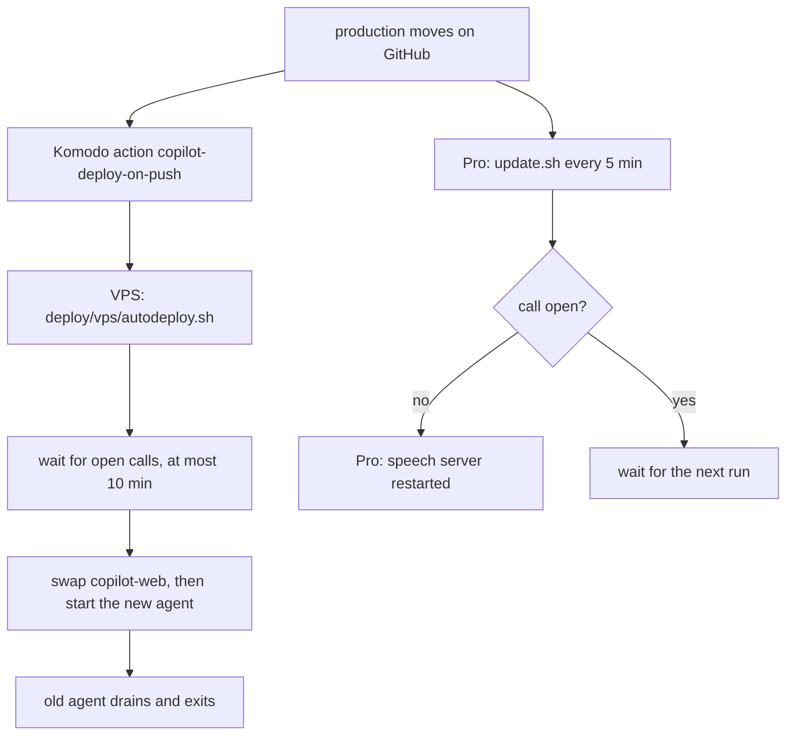

# Deploying the copilot lab

A merge to `main` goes live by itself: when CI passes, `.github/workflows/promote.yml` moves `production` to that commit and the lab deploys ([decision 0016](../docs/decisions/0016-merges-go-live.md), which replaces 0015). You can still move `production` by hand with `git push origin main:production`, for example to roll back one commit. The site is https://copilot.design-bakery.com.

1. Komodo's `copilot-deploy-on-push` action checks GitHub every 5 minutes. When `production` is ahead of the running `copilot-web` image, it deploys the `copilot` stack.
2. That stack's pre-deploy runs [`vps/autodeploy.sh`](vps/autodeploy.sh). It builds both images tagged with the commit, waits for open calls (below), swaps `copilot-web`, waits for `/api/health` (and puts the previous image back if that fails), then starts the new voice agent beside the old one.
3. On the MacBook Pro, [`pro/update.sh`](pro/update.sh) moves its checkout to `production` within 5 minutes and restarts the speech server, unless a call may be using it (below).

## A deploy does not cut a call

Every merge to `main` deploys (decision 0016), so a deploy while someone is on a call is the normal case (#67, #76). Three things keep it from hurting.

**The voice agent drains.** The agent is not in `docker-compose.vps.yml`: [`docker-compose.agent.yml`](docker-compose.agent.yml) runs one container per release (`copilot-agent-<12-char sha>`, its own compose project), so Komodo's `compose up` never replaces it. A new agent starts beside the old one and must log `registered worker` (LiveKit has accepted it) before the old one is told to stop. LiveKit sends each new call to a worker that has room, and a worker that is draining has none. The old agent gets SIGTERM; LiveKit Agents 1.8.8 (`cli/cli.py`, `worker.py`) then calls `drain()` in `start` mode: it reports itself full, keeps the jobs it holds, and exits when they end, or after `drain_timeout` (the agent sets `AGENT_DRAIN_S`, default 1200 s; the library's own default is 3600 s). `stop_grace_period` in the compose file (1230 s) is longer than that, so a plain `docker stop` also waits. `autodeploy.sh` turns the old container's restart policy off first (otherwise Docker would start it again when it exits) and does not wait for it; the next deploy removes the finished container. A call longer than 20 minutes after its agent was told to stop is cut when the drain times out.

**Anything that drops a call waits for it.** Before the site (it carries LiveKit's signalling at `/rtc`), LiveKit, or the speech bridges (only when their configuration changed) are restarted, `autodeploy.sh` lists LiveKit's rooms with the server's own key from `~/apps/copilot.env` ([`vps/open-calls.py`](vps/open-calls.py), run in a throwaway container of the agent image). If a room holds anyone but the agent it waits up to `CALL_WAIT_S` (600 s) and then goes on, so a call someone forgot to hang up cannot stop a release. If LiveKit cannot be asked it does not wait. On the Pro, `update.sh` skips its whole update (checkout and speech-server restart) while the site's `GET /api/voice/calls` says a room is open, while the speech server's `/health` reports `inflight` requests, or for `SPEECH_IDLE_S` (20 s) after the last one; launchd runs it again in 5 minutes, and after `CALL_WAIT_S` (600 s) from the first skip it goes on. A site that cannot be reached does not hold it back. The first rollout after this change has no protection on the Pro, because the old speech server and site do not report these counts yet.

**The record.** Each deploy writes a line to `deploy/deploy.log` on the VPS (and to Komodo's log), for example `deploy 3f2a9c1d4e5b: wait=gave-up waited=600s calls_at_start=1 calls_at_end=1 for='swapping the site' agent=started drained=1 restarted='web' took=655s`, and a `deploy` span to Phoenix through Octo (session `deploy-<sha>`, the same session as the voice check's eval span), with `deploy.wait_result` (`none`, `waited`, `gave-up`, `unknown`), `deploy.waited_s`, `deploy.calls_at_start`, `deploy.calls_at_end`. A call that was cut shows up next to the deploy that did it. The Pro writes its decisions to `~/Library/Logs/copilot/update.log` (`deferred, waited ...`, `still busy after ...`, `calls ended after waiting ...`).

Limits: the wait ceiling (600 s) plus the build must fit in Komodo's pre-deploy timeout; if Komodo cuts the script earlier, lower `CALL_WAIT_S`. The first deploy after this change replaces the old fixed-name `copilot-agent` container: it is drained like any other, but Komodo's own `compose up` may remove it as an orphan of the stack, once.

Tests: `npm test` runs [`tests/deploy-keeps-calls.test.ts`](../demo/live-site/tests/deploy-keeps-calls.test.ts) (the scripts with a stand-in for `docker`, and `update.sh` in a scratch git repository). `npm --prefix demo/live-site run test:deploy-sequence` runs the whole sequence on a scratch Docker project with a real call: it deploys, starts a call with audio from macOS `say`, deploys again, and checks the call is still heard, the old agent drains and exits, and the next call goes to the new container.

## Where each part runs

| Part | Machine | How it's reached |
|---|---|---|
| Site and `/api` (`server.ts`) | VPS, `copilot-web` | Cloudflare tunnel A → `copilot-web:8787` |
| LiveKit signalling | VPS, `copilot-livekit:7880` | through `server.ts` at `/rtc` |
| Call audio (WebRTC) | VPS, `copilot-livekit` | the VPS's public address, TCP 7881 and UDP 7882 |
| Voice agent (`speech/agent.py`) | VPS, `copilot-agent-<sha>` (one per release; the old one drains) | joins every call's room |
| Speech models, all five stacks (`speech/server.py`) | Pro, `com.pukujan.copilot-speech` | reverse tunnel → VPS `127.0.0.1:18799` |
| LFM3-Audio (the `lfm3-audio` stack) | Pro, started by the speech server | reverse tunnel → VPS `127.0.0.1:18798` |
| LFM3 text model | Pro, `com.pukujan.lfm3` | nyc-map-agent's tunnel and bridge → `18099` |

The speech models stay on the Pro because Whisper (mlx-whisper) and LFM3-Audio's llama.cpp build run on Apple's GPU, where the voice matrix tested them (#82). Only the stack a call uses is loaded (decision 0014). If the Pro is asleep, voice calls fail, but text chat still works.

## Keys

The containers read `~/apps/copilot.env` on the VPS (mode 600, never in git):

| Name | From |
|---|---|
| `OPENROUTER_JEV_KEY` | `openrouter_jev_only` in `~/Documents/projects/.env` |
| `OCTO_KEY`, `OCTO_WORKSPACE` | `octo_db_chatbots`, `octo_db_chatbots_workspace` |
| `SIGNING_SECRET` | random, made on the VPS |
| `LIVEKIT_API_KEY`, `LIVEKIT_API_SECRET`, `LIVEKIT_KEYS` | random, made on the VPS; `LIVEKIT_KEYS` is `key: secret` |

## First-time setup (done once, 2026-11-01)

- VPS: `git clone https://github.com/Pukujan-lab/voice-agent-research ~/apps/copilot`, write `~/apps/copilot.env`, then run `deploy/vps/autodeploy.sh` once.
- Pro: clone the repo to `~/apps/copilot` and put the speech models in `demo/live-site/speech/models/` (sources in `speech/requirements.txt`). Then run `deploy/pro/install.sh`.
- Cloudflare: tunnel A gets the public hostname `copilot.design-bakery.com` → `http://copilot-web:8787`.
- Komodo: the `copilot` stack and the `copilot-deploy-on-push` action live in `Pukujan-lab/server-management` (`komodo/resources/stacks-vps.toml`).

## Checking it

- Health: `curl https://copilot.design-bakery.com/api/health`
- VPS logs: `ssh vps 'cd ~/apps/copilot/deploy && docker compose -f docker-compose.vps.yml logs --tail 50; docker logs --tail 50 $(docker ps -q --filter label=copilot.role=agent)'`
- Pro logs: `ssh mac-pro 'tail ~/Library/Logs/copilot/*.log'`
- Agents: `ssh vps 'docker ps -a --filter label=copilot.role=agent'`; deploy decisions: `ssh vps 'tail ~/apps/copilot/deploy/deploy.log'`
- A commit that failed is kept in `deploy/.deploy-failed` and isn't retried. Delete that file to retry it.
