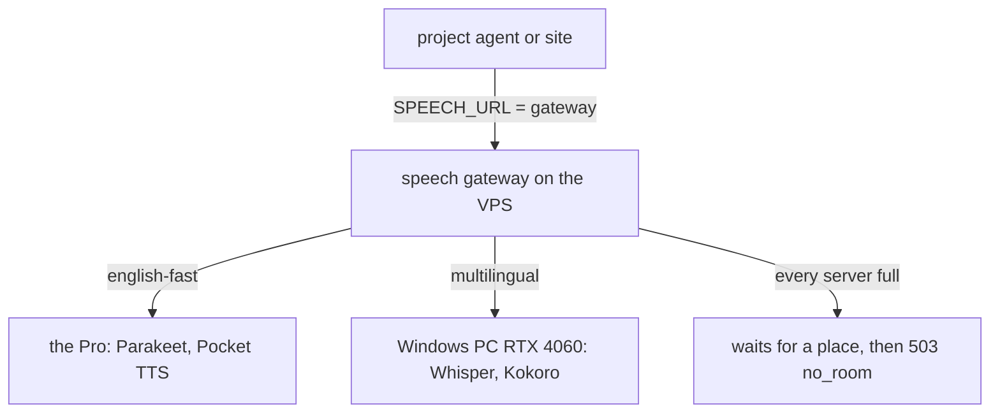

# The speech gateway: our speech models, hosted once, for every live call

Every project that listens or speaks with our own models goes through one gateway on the VPS: the copilot (and the
Design Bakery live call, which uses it), Riley, Maybe Home, NYC map, Precedent, and the next one. The gateway speaks the
speech server's own API, so a project points its speech URL at it and nothing else has to change. Which server takes a
call is decided in one file, [`demo/live-site/speech/gateway/routes.toml`](../demo/live-site/speech/gateway/routes.toml)
([decision 0023](decisions/0023-one-speech-gateway.md)).

- **English** (stack `english-fast`) goes to the Pro. When the Pro is full it overflows to the Windows PC, which hears
  English with Whisper and speaks it in Kokoro's English voice.
- **Every other language** (stack `multilingual`) goes to the Windows PC first, then the Pro.
- **A full server is passed over**, and so is one whose models another call is using (one stack is resident at a time).
- **When every server is full** the project's `when_full` decides. Every project is on `wait` (owner, 2026-11-08): the
  request waits up to `wait_s` for a place, then gets a 503. `cloud` (answer 503 at once so a cloud fallback takes the
  call) is there for when the owner switches cloud speech back on; no active chain has a cloud voice.

## How a call is routed

| Request | Where it goes |
|---|---|
| Carries `X-Speech-Call: <room>` | Pinned: the whole call stays on one server. A new stack (the caller picked Spanish) moves it along the new stack's route. |
| No call id | The first server for its stack with room, not pinned. |
| `POST /place?stack=` | Takes the call's place now and says which server, without loading anything; 503 when there is no room. A client checks this at call start to know at once whether to use its fallback. |
| `POST /lease?id=<room>` | Keeps the call's place without speech. A call silent for `idle_s` (90 s) gives its place back. |
| `POST /release` | Frees the call's place at once (send it when the call ends). |
| `POST /warm?project=<name>` | Loads the project's `warm` stacks on their first servers ahead of a call; answers at once. |
| `GET /health` | The pinned (or first) server's own health, plus every server's calls under `gateway`. |
| `GET /routes` | The routes live now, and the error if the last edit was refused. |

## How to change routing or fallbacks

Routing and fallback chains live only in config files. Change them **only when the owner asks, and never switch cloud
speech on by yourself**: Deepgram and Cartesia cost money per minute.

| File | What it decides |
|---|---|
| [`demo/live-site/speech/gateway/routes.toml`](../demo/live-site/speech/gateway/routes.toml) | Every project: which speech servers exist (`[[host]]`: `url`, `stacks`, `max_calls`), which server each stack tries in order (`[route]`), and per project (`[defaults]`, `[project.<name>]`) what happens when all are full (`when_full`, `wait_s`), what loads ahead of a call (`warm`) and the stack for a request that names none (`stack`). Where the gateway listens (`[listen]`). |
| nurse-screen and take2-riley `screen.yaml`, `stack.listens` / `stack.speaks` | Riley's own chain: the first entry hears or speaks, the next takes over when it fails. Only `pro-speech` (the gateway) is active; Deepgram and Cartesia are commented entries, and so is `dana.voice` (Dana's recorded lines play from the kept clips). nurse-screen is the source; `scripts/sync_riley.py` in take2-riley copies it there. |
| `SPEECH_URL` / `SPEECH_PROJECT` in each project's compose file | Which gateway a project uses and the name it goes by (copilot `deploy/docker-compose.agent.yml`, Design Bakery `deploy/vps/docker-compose.yml`, Maybe Home `deploy/docker-compose.vps.yml`, NYC map `STT_BASE_URL` in the VPS's `~/apps/nyc-map-agent.env`). They have no chain of their own: a 503 is an error there. |

**Switch cloud speech back on** (only on the owner's word): uncomment the Deepgram and Cartesia entries in Riley's
`screen.yaml` (both repos), and `when_full = "cloud"` in its `[project.riley]` block so a full gateway answers at once.
The keys and code paths are still in place.

**How a change goes live.** `routes.toml`: merge to `main`; `promote.yml` moves `production`, the copilot deploy moves
the checkout the gateway reads, and the gateway reads the new file on its next request (a `[listen]` change takes a
restart of the `speech-gateway` stack). `screen.yaml`: merge in nurse-screen, sync to take2-riley and merge there; each
deploys on its own. A compose change: merge in that project; its Komodo stack redeploys.

**How to check.** On the VPS (`ssh vps`): `curl -s 127.0.0.1:18800/routes` shows the routes live now and the error if
the last edit was refused; `curl -s 127.0.0.1:18800/health` shows each server up or down and the calls on it;
`docker logs --since 10m speech-gateway` has one line per call, `call <room> (<project>) <stack> -> <server>`.

### Switch or upgrade routing

Edit `routes.toml` and merge to `main`. The copilot deploy moves the checkout the gateway reads, and the gateway picks up
the new file on its next request without a restart. A file that doesn't parse, or names a host or stack that doesn't
exist, is refused and the last good one stays (`GET /routes` shows the refusal).

- **A new GPU box:** one more `[[host]]` block, and its name in the `[route]` lines.
- **More calls per server** (more model copies on one GPU): raise that host's `max_calls`.
- **Send a language somewhere else:** reorder its `[route]` line. `host:stack` runs another stack on that host.
- **A project that must never wait, or never use the cloud:** its `[project.<name>]` block.

## Add a project (the business agent, and every one after)

1. Point its speech URL at the gateway: `SPEECH_URL=http://host.docker.internal:18800` with
   `extra_hosts: ["host.docker.internal:host-gateway"]` in a container, `http://127.0.0.1:18800` for a host process.
2. Send `X-Speech-Project: <name>` and, per call, `X-Speech-Call: <room>` on every speech request (and the `/stt/stream`
   WebSocket). Copy [`client.py`](../demo/live-site/speech/gateway/client.py) for a Python agent; in TypeScript it is two
   headers on `fetch`. Release the call when it ends.
3. Treat a 503 `no_room` as "every server is full": the project's error path. Only a cloud fallback the owner switched on
   may take it.
4. Optional: a `[project.<name>]` block for `when_full`, `wait_s` and `warm`.

Without step 2 a project still works, unpinned. The gateway itself copies too: one folder and
[`deploy/speech-gateway/`](../deploy/speech-gateway/), run with another `routes.toml`.

## Where it runs

Komodo stack `speech-gateway` on the VPS (server-management `komodo/resources/stacks-vps.toml`), from the copilot's
checkout at `production` (`~/apps/copilot/deploy/speech-gateway`). Host networking: it reaches the Pro's tunnel
(`127.0.0.1:18799`) and the Windows PC over the tailnet (`agents.tail7065c3.ts.net:6799`), and listens on loopback and
the docker bridge (172.17.0.1, `host.docker.internal`) in `routes.toml [listen]`, never a public address. A deploy that changes `gateway.py` makes it exit
and Docker start it again; calls are pinned again on their next request.

Tests: `npm run test:gateway` (fake speech servers).
